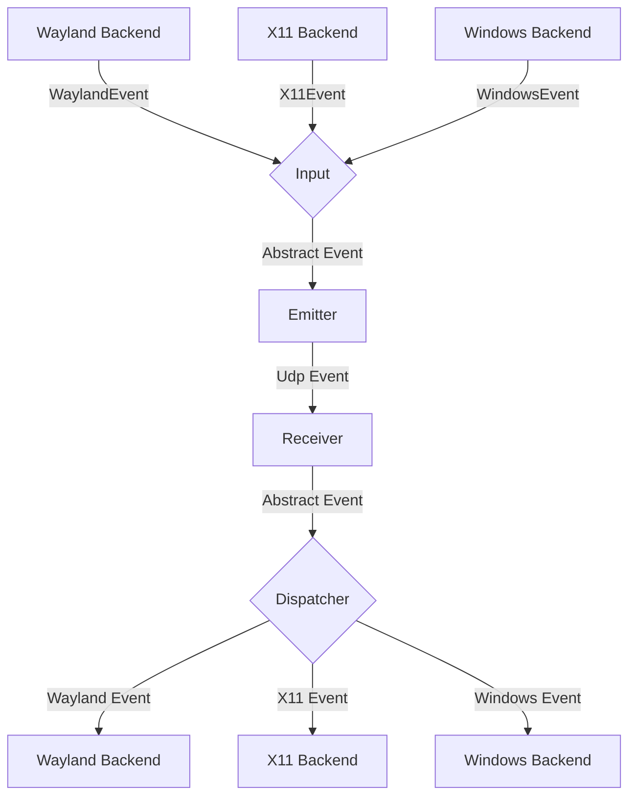
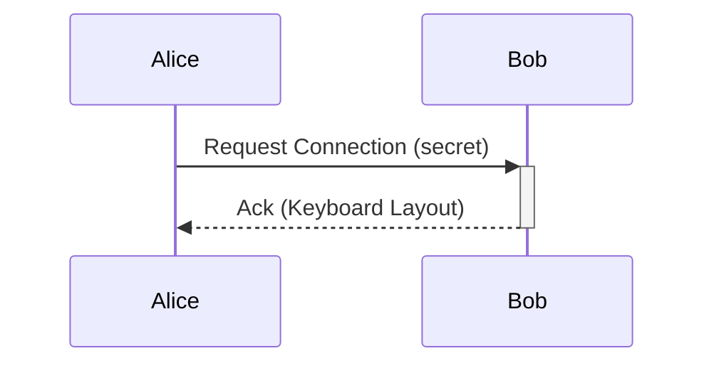

# General Software Architecture

## Events

Each instance of lan-mouse can emit and receive events, where
an event is either a mouse or keyboard event for now.

The general Architecture is shown in the following flow chart:

### Input
The input component is responsible for translating inputs from a given backend
to a standardized format and passing them to the event emitter.

### Emitter
The event emitter serializes events and sends them over the network
to the correct client.

### Receiver
The receiver receives events over the network and deserializes them into
the standardized event format.

### Dispatcher
The dispatcher component takes events from the event receiver and passes them
to the correct backend corresponding to the type of client.

### Absolute pointer & geometry

Crossing a barrier moves the pointer to the matching spot on the peer, also
when the two screens have different sizes or are vertically offset:

- On connect, the receiving side replies to `ProtoEvent::Enter` with
  `ProtoEvent::Geometry`, the bounding box of its screenspace in pixels plus
  the outermost pixel on each edge (that is where its pointer can be warped).
- While a peer drives the pointer, motion is reported as
  `PointerEvent::Position` (absolute, local screenspace pixels). The sender's
  own screen edge is mapped onto the peer edge with the fraction along the
  shared axis (`lan_mouse_proto::geometry`).
- Peers that can place their pointer absolutely (Windows, macOS, X11, libei)
  follow the position directly. Peers that only accept relative motion get
  the absolute positions turned into scaled deltas. Backends that are only
  readable (e.g. layer-shell capture) keep using relative `Enter` / `Leave`.
- Every edge without an active client is still captured: entering such an
  edge hands control back to the incoming peer, whose `Geometry` then places
  our pointer back on the edge when we return.

## Requests

// TODO this currently works differently

Aside from events, requests can be sent via a simple protocol.
For this, a simple tcp server is listening on the same port as the udp
event receiver and accepts requests for connecting to a device or to
request the keymap of a device.

## Problems
The general Idea is to have a bidirectional connection by default, meaning
any connected device can not only receive events but also send events back.

This way when connecting e.g. a PC to a Laptop, either device can be used
to control the other.

It needs to be ensured, that whenever a device is controlled the controlled
device does not transmit the events back to the original sender.
Otherwise events are multiplied and either one of the instances crashes.

To keep the implementation of input backends simple this needs to be handled
on the server level.

## Device State - Active and Inactive
To solve this problem, each device can be in exactly two states:

Either events are sent or received.

This ensures that
- a) Events can never result in a feedback loop.
- b) As soon as a virtual input enters another client, lan-mouse will stop receiving events,
which ensures clients can only be controlled directly and not indirectly through other clients.

